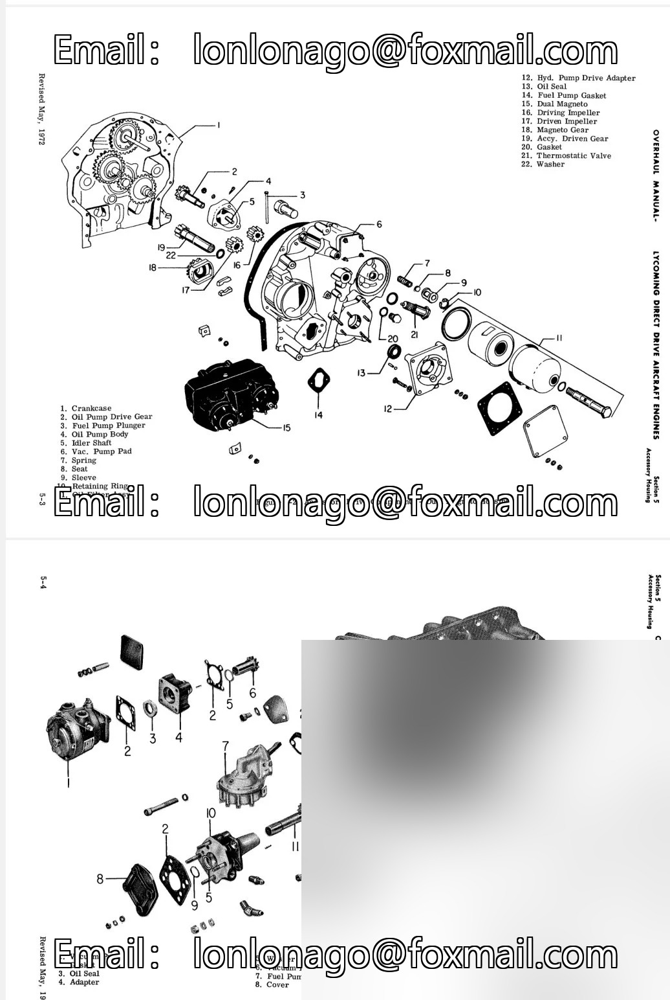
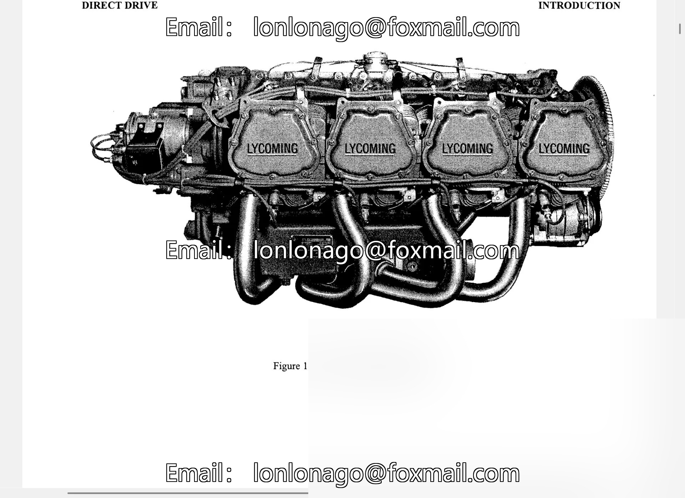

# Kaleiming direct-drive engine overhaul manual (FAA approved version, sixth printing, part number 6)

## Body

Kelongming direct-driven engine major repair manual (FAA approved edition, sixth printing, part number 60294-7) Kelongming direct-driven engine major repair manual, FAA sixth printing edition, part number 60294-7, 280 pages.
complete contents, suitable for maintenance, learning and reference.

The FAA-approved maintenance manual for Lycom direct drive engines is the sixth printed edition, suitable for repair and study; the image lists specific part names and version information.

<!-- AI_ENRICHED -->

## Images

## Payment

Here is a pay link on Stripe ( https://buy.stripe.com/3cs8yP7sY87d0vu9AB ). Please contact me lonlonago@foxmail.com after funding $89, and I will send you a complete data files , thank you!

